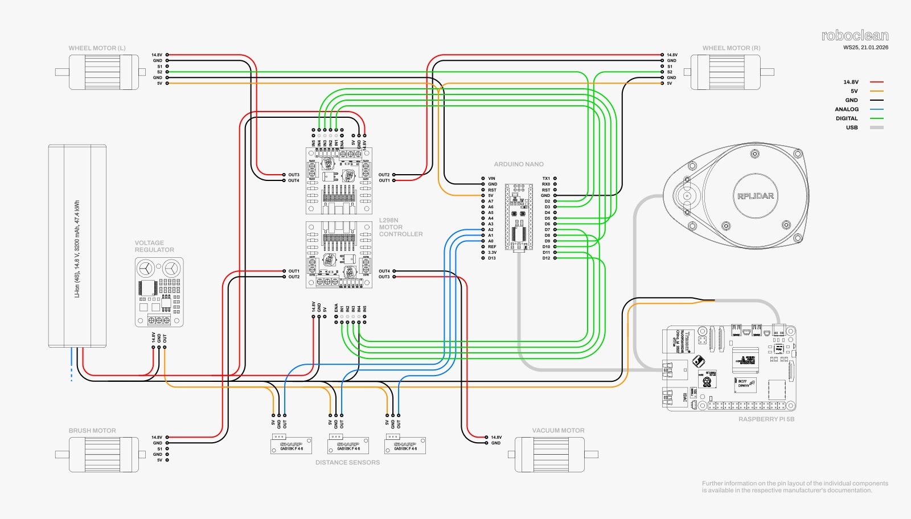

# Hardware

[← Docs](../README.md)

This folder describes the hardware components used in the project and
links to device-specific READMEs.

## Table of contents

- [Arduino](Arduino/README.md)
- [Raspberry Pi](RaspberryPi/README.md)
- [RPLidar](RPLidar/README.md)
- [Battery](Battery/README.md)

[← Docs](../README.md) | [Arduino →](Arduino/README.md)

## Overview

The whole robot setup is built around a Raspberry Pi 5. For power, a 14.8V 3800mAh Li-Ion battery is used together with a 5V step-down converter to supply the required voltage for the whole setup.

All hardware parts:

- Raspberry Pi 5
- Arduino Nano V3
- RPLIDAR A1 360° Laser Scanner 
- 14.8V 3800mAh Li-Ion Battery
- 2x Motor Controller [L298N](https://www.reichelt.de/de/de/shop/produkt/entwicklerboards_-_motodriver2_l298n-202829)
- [5V DC StepDown Converter](https://www.reichelt.de/de/de/shop/produkt/entwicklerboards_-_spannungsregler_dc_dc-wandler-333855)
- LG VR6340 vacuum robot

### Wiring

### Case Modifications

To fit all the hardware inside the robot, the following changes were made:

1. Old motherboard removed
2. Original battery removed and sidewalls cut away
3. Power switch removed
4. LiDAR mounted to topcase cover
5. Mount in topcase for dirt basket removed due to clearance issues

### Custom Mounting Bracket

To fit the battery, motor controller, DC step-down converter, and Arduino, we created a custom mounting bracket that uses the old motherboard mounts.

(Printable file can be found in HeiBOX.)

### Motor Information

The Arduino sends a digital PWM (Pulse Width Modulation) signal to the motor driver to control the speed of both motors. This allows control over the amount of power delivered to the motors.
Each motor includes a wheel encoder. The encoder sends 514 pulses per revolution, which are processed by the Arduino. Currently, only one of the two signal wires is connected, as the second signal wire is only needed to determine the rotation direction.

### Unused Hardware

Some original parts of the LG Vacuum Robot had no further use to us and / or took up too much space and were therefore removed.

- 1 power switch, originally mounted in the back of the robot
- 2 switches on top of the wheel motors, originally used to detect when the wheels do not touch the ground
- 4 IR sensors, originally positioned at the front and on both sides, but unnecessary due to the LiDAR unit

